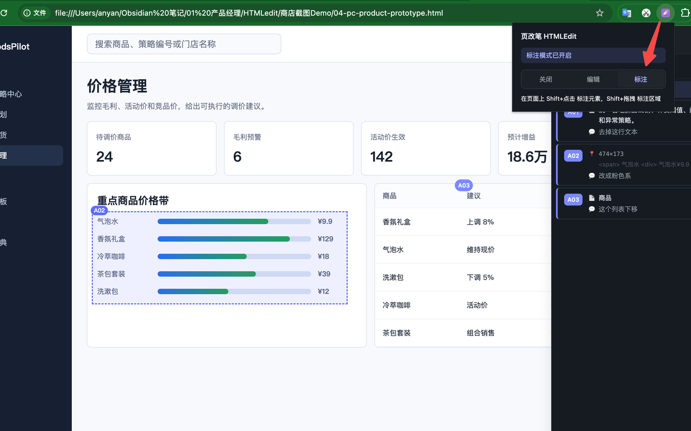
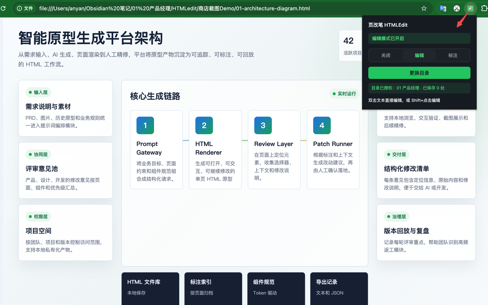
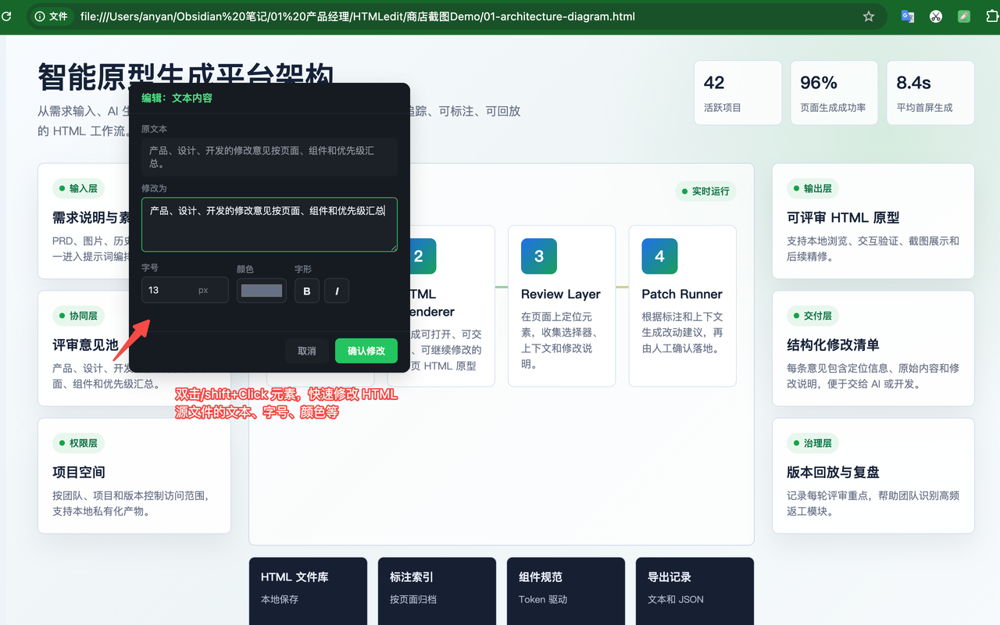
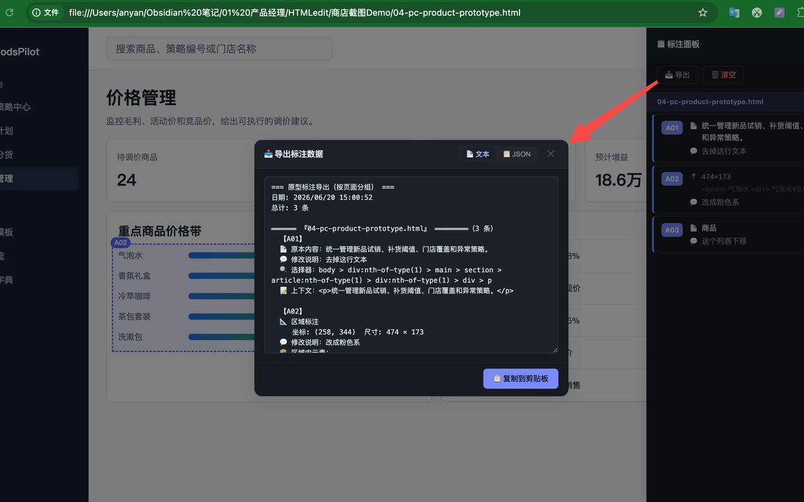

# HTMLEdit

[简体中文](README.md) · English

> A fine-tuning tool for what comes after AI generates HTML. Edit text and lightweight styles directly in local HTML; Annotate mode turns design changes into structured input for AI or developers.
>
> Chrome MV3 extension · Pure vanilla JavaScript · Zero dependencies
>
> **Author**: [@Allenyan07](https://github.com/Allenyan07)

[](#installation) [](#license) [](#architecture)


> Annotate mode: Shift+Click an element to annotate it; location info is captured automatically and exported as structured text for AI


> Edit mode: double-click a text element to edit it, with lightweight style adjustments such as font size and color


> Editing: once confirmed, the change is saved in place to the local file through the File System Access API


> Export annotations: packed by page in both text and JSON, copied to the clipboard in one click for AI or developers

---

## Why this exists

Decks, architecture diagrams, product prototypes, event posters — more and more of this is generated directly as HTML by AI. Compared with traditional formats like PPT and Axure, HTML is more expressive, its interactions feel closer to the real thing, and it can run animations and logic directly, which is a clear advantage for a first draft.

But HTML has a weak spot, and it stings most during the fine-tuning stage: **changing a single line of copy is painful**.

In PPT you double-click a text box and type. Same in Axure. But HTML is code: to change "Draft" to "Pending review", you have to find the matching `<span>`, edit `textContent`, save the file, and refresh. Copy the whole HTML into an AI just to change one string? Overkill, and it is easy to break something else along the way.

HTMLEdit's Edit mode fills that gap. For local HTML, double-click a text element to change its text and lightweight styles, and write the change back to the source file inside the folder the user authorized — as direct as editing a text box in PPT.

What about interaction styles and design decisions — "this status tag is the wrong color", "redo this layout", "add a data dashboard here"? Those are not good candidates for manual edits; they belong with AI. The problem is telling the AI exactly where "here" is. A verbal description is too vague, screenshot markup loses context, and a hand-written prompt tends to drop location details.

HTMLEdit's Annotate mode solves that. Annotate the exact spots on the page, with the CSS selector and HTML context captured automatically, then export structured text or JSON in one click for an AI, an issue, a PRD, or a dev doc.

Two modes, two kinds of problems: **Edit mode handles text and lightweight styles, Annotate mode handles design changes**.

```
AI-generated draft
  ├─ Text or light styling to fix?  → Edit mode: double-click / Shift+Click, save in place
  └─ Design or flow to change?      → Annotate mode: precise annotations + export
```

---

## Core features

### Edit mode: the direct editing that HTML never had

HTML is expressive, but it has no double-click-and-edit text entry point like PPT or Axure. Edit mode lets local HTML be edited for text and lightweight styles as directly as a design file.

- **Direct editing**: double-click a text element (or Shift+Click) to open an edit card; confirm and the change takes effect
- **Lightweight styles**: common text style adjustments such as font size, color, bold, and italic
- **Save in place**: overwrite the local HTML file inside the authorized folder through the File System Access API — no download prompt, no copy created
- **Authorize once**: authorize the prototype folder once on first use; later edits save silently
- **Undoable**: undo the last change after a successful save; a failed save rolls the page DOM back
- **Edit marks**: edited elements get a green dashed border (`#22c55e`) plus a light green background, visible within the session and cleared when you leave Edit mode
- **Supported elements**: common text elements such as input, textarea, button, a, label, span, p, div, h1-h6, td, th, li

Good for: changing copy, placeholders, button labels, or headings, and tweaking text styles — any change that does not require restructuring the page. No need to send the whole HTML to an AI just to fix one string.

> Note: save in place only applies to local HTML files inside the folder the user authorized. Online pages can be annotated and inspected temporarily, but changes cannot be written back to a remote site's source files.

### Annotate mode: hand "change this" to AI precisely

When interaction styles or design decisions need to change, editing by hand is not realistic; that work belongs with AI. But AI needs an exact location and a clear intent.

- **Element annotation (Shift+Click)**: click any element to open an annotation card and fill in "Change to" and "Note"
- **Area annotation (Shift+drag)**: drag a box around a region and describe it as a whole — good for "add a new component here" or "redo this whole block"
- **Automatic location info**: every annotation generates a CSS selector path plus the parent HTML context (first 600 characters), so AI can find the exact line of code
- **Badge numbers**: A01, A02... badge numbers sit at the element's top-right corner, follow scrolling, and can be clicked to edit again
- **Status flow**: annotations move between Pending, Done, and Rejected to track review progress
- **Cross-page rollup**: annotations from multiple HTML pages are shown grouped by page in a single panel

Good for: style tweaks, interaction changes, layout rework, and new components — any structural change that AI should make.

### Export: the deliverable of Annotate mode

Annotations are packed by page and handed to AI or developers.

- **Grouped by page**: the exported text is grouped by page, each group with a page header and a count
- **Structured fields**: each annotation includes its number, original 📄, changed ✏️, note 💬, status, CSS selector, and HTML context; area annotations also include coordinates, size, and covered elements
- **Two formats**: text (for people) and JSON (for programs), chosen by switching tabs
- **One-click copy**: copy to the clipboard, then paste into an AI chat, an issue, a PRD, or a dev handoff doc

Example exported text:

```
=== 原型标注导出（按页面分组） ===
日期: 2026/6/19 14:00:00
总计: 2 条

══════ 『创建规则页』 ══════（2 条）

  【A01】
  📄 原本内容：暂存
  💬 修改说明：状态标签颜色改为橙色，和待审核状态区分开
  状态：pending
  选择器：table tbody tr:nth-of-type(1) td:nth-of-type(7) .status-tag
  上下文：<span class="status-tag status-tag-pending">已提交</span>

  【A02】
  📐 区域标注
  💬 修改说明：这里新增一个数据看板组件，展示实时库存
  区域坐标：left:160, top:240, width:400, height:300
  覆盖元素：button、table、span.status-tag
=== 导出结束 ===
```

> Note: the extension UI and its exported text are currently Chinese-only — the sample above is
> the real output, left untranslated so it matches what you will actually see.
>
> Note: annotation cards also support a "Change to" field for suggesting text replacements, but direct copy changes are better made with Edit mode's save in place — Annotate mode is mainly for design and interaction changes.

---

## Installation

### Option 1: Chrome Web Store (recommended)

> https://chromewebstore.google.com/detail/%E9%A1%B5%E6%94%B9%E7%AC%94-htmledit/anoalbchnoloccjahdilckdcgbkikakg?authuser=0&hl=zh-CN

### Option 2: Load from source (developers)

1. Clone this repository

   ```bash
   git clone https://github.com/<your-username>/<repo-name>.git
   ```

2. Open Chrome and go to `chrome://extensions`
3. Turn on "Developer mode" in the top right
4. Click "Load unpacked" and select the repository root (the folder containing `manifest.json`)
5. The extension icon appears in the toolbar; click it to start using the extension

### Using local HTML files

To use it on local HTML files (for example, AI-generated prototypes or HTML inside an Obsidian vault):

1. Find HTMLEdit in `chrome://extensions` and click "Details"
2. Turn on "Allow access to file URLs"
3. Open the local HTML file directly in Chrome

---

## Workflows

### Scenario 1: change text and lightweight styles — use Edit mode

1. Generate the product prototype HTML with AI, save it locally, and open it in Chrome
2. Click the extension icon, authorize the prototype folder, and switch to Edit mode
3. Double-click or Shift+Click the copy you want to change, edit the text, font size, color, and so on, then confirm
4. The change is written back to the HTML file inside the authorized folder; refresh to see the result

No need to copy the whole HTML into an AI just to fix one string.

### Scenario 2: adjust the design — use Annotate mode and export to AI or developers

1. Switch to Annotate mode; the side panel opens on the right
2. Interaction style to change? Shift+Click the element → fill in the note (for example, "change the status tag color to orange")
3. Whole block to redo? Shift+drag to select the area → describe it
4. Click "Export" in the panel, choose the text format, and copy it to the clipboard
5. Paste it manually into an AI chat, an issue, or a dev doc so the other side can make the second round of changes with exact selectors and context

### Scenario 3: prototype review handoff

1. The PM annotates every requested change on the prototype
2. Export the structured text
3. Hand it to a developer, who opens the export and jumps straight to the corresponding elements

---

## Architecture

### Chrome MV3 extension, zero dependencies

```
manifest.json              # MV3 config
background.js              # service worker — message routing + mode state + FSA writes
popup.html / popup.js      # three-state mode switch (Paused / Edit / Annotate)
content/
  storage.js               # chrome.storage.local wrapper
  selector.js              # CSS selector generation + element lookup
  messaging.js             # message send/receive + cross-frame messaging
  area-selector.js         # Shift+drag area annotation
  annotator.js             # annotation core: hover highlight, Shift+Click card, badges
  editor.js                # edit mode: hover highlight, double-click / Shift+Click card
  panel.js                 # side panel: list, grouping, export, floating button
  content.js               # top-level wiring: mode activate/deactivate, dispatch
  content.css              # injected styles
icons/                     # 4 icon states (default/inactive/active/edit)
```

### Key technical points

**File System Access API save in place**

The biggest technical challenge in Edit mode is reliably overwriting the original HTML file under the `file://` protocol. The final approach persists the user-authorized folder handle (`FileSystemDirectoryHandle`) in IndexedDB from the background service worker, so after the first authorization writes happen silently with no file picker. See `getWritableFileHandle` and `saveEditedHtml` in `background.js`.

**Cross-frame injection**

Prototype pages often load subpages through `<iframe>`, and events cannot cross frame boundaries. We enumerate every frame with `webNavigation.getAllFrames`, then send messages to each frame through `chrome.tabs.sendMessage` with a `frameId`, which makes annotation and editing work on pages inside iframes.

**Shadow DOM isolation**

All tool UI (panel, cards, badges) is isolated with Shadow DOM, so page CSS cannot pollute it and tool styles cannot affect the page.

**Zero dependencies**

Pure vanilla JavaScript — no jQuery, React, or Vue, and no build step. All logic is IIFE modules loaded in the order of the `content_scripts.js` array in the manifest.

### Permissions

| Permission | Purpose |
|------|------|
| `activeTab` | Enable current-tab features when the user selects a mode |
| `scripting` | Ensure content scripts are injected and the matching mode is active |
| `storage` / `unlimitedStorage` | Store annotation data locally |
| `webNavigation` | Enumerate frames in order to inject into iframes |
| `host_permissions` | Support `file://` local HTML and annotation/temporary inspection on `http(s)://` pages |

The extension does not upload user data to developer servers or third-party services. When the user copies exported content and pastes it into an AI or a collaboration tool, that transfer is initiated by the user.

---

## Who it's for

- People who generate HTML prototypes, posters, or decks with AI and want to fix copy and lightweight styles quickly without sending the whole HTML to an AI — use Edit mode
- People who need to adjust the interaction styles or design of an AI first draft and want to hand it to AI for fine-tuning after precise annotation — use Annotate mode
- Product managers and designers running prototype reviews who need to hand change requests to developers in a structured form
- Developers receiving a change ticket who want to open the export and jump straight to the corresponding elements

---

## Development

### Requirements

- Chrome 102+ (needs the File System Access API and MV3)
- No Node.js and no build step

### Local development

1. Clone the repository
2. `chrome://extensions` → turn on Developer mode → load the repository root (the folder containing `manifest.json`)
3. After changing code, click the "Reload" button on the extension card to reload

### Directory structure

```
.                                 # repository root IS the folder you load into Chrome
├── manifest.json                 # MV3 manifest
├── background.js                 # service worker
├── popup.html / popup.js / popup.css
├── auth.html / auth.js           # directory authorization (File System Access)
├── content/                      # content-script modules (edit / annotate / source patch)
├── icons/                        # 4 icon states
├── test-fixtures/                # regression tests and repro pages
├── 商店截图/                      # store screenshots
├── README.md / README.en.md
├── PRIVACY.md
└── LICENSE
```

---

## Changelog

### v2.1.0 (2026-10-18)

**Added**

- **Bottom-right mode pill**: the color is the current mode (gray = Paused / green = Edit / purple-blue = Annotate); hover expands it into three segments you can click to switch, and the old panel handle is now part of it. It hides automatically while paused and only appears when the mouse moves to the bottom-right corner
- **Keyboard shortcuts**: `⌥Q` for Edit, `⌥W` for Annotate (press again to return to Paused), `⌥E` to export annotations (Annotate mode only). They go through browser-level `chrome.commands`, so pages cannot steal the keystrokes; key hints follow your system (macOS shows `⌥`, Windows shows `Alt+`)
- **Annotation count badge**: the pill shows the number of annotations on the current page in its top-right corner
- **The extension popup shows the current mode's shortcut**, so you do not have to memorize it or dig through docs

**Improved**

- **Authorization no longer stands in front of Edit mode**: you can go straight into Edit mode and edit; authorization is only needed on the first real save, in a single click, and **the save then completes automatically once authorization succeeds**, so no text is lost
- **Esc only closes the topmost layer**: if a card is open it closes the card (without collapsing the pill), and only when nothing else is open does it collapse the pill; **in no case does it clear annotation highlights on the page**
- "Off" was renamed to "Paused", which is more accurate

**Fixed**

- Elements rendered dynamically by JS **could not be located or saved** (P1-09): they are now safely back-filled in the script template in the source file, with the exact line number reported
- The text heuristic **wrote an edit onto a different element with the same text** (P1-10): edits are now validated against class compatibility, and refused outright instead of silently written to the wrong place
- **A successful save polluted the mode state**: after the browser recycled the background, one save receipt would flip the mode to Paused and reset the edited count to zero, so a refresh dropped the extension out of Edit mode
- **Authorization window infinite loop**: when a file was outside the authorized folder, "Re-authorize" could never fix it and fell into a loop of failure → dialog → authorize → still failing → dialog again
- **Export annotations was completely unusable**: `Ctrl+Shift+E` had thrown an error since v2.0.6
- Rolling back a failed save **destroyed links/buttons inside the element**
- `Ctrl+Z` in page input fields was hijacked by the extension in Edit mode
- The last keystroke was swallowed when switching modes quickly
- Authorizing from inside an iframe bound the folder to the wrong path

### v2.0.6

- Added a source-file literal back-fill fallback: copy rendered at runtime by page scripts can be edited too
- Fixed the text heuristic hitting the wrong target: the same tag and text on a different element is no longer silently miswritten
- Source-structure scanning replaced the wrong assumption that "text immediately before `>` marks an element boundary" (that assumption had 6 reproducible classes of false positives)

### v2.0.5

- Edit mode rework: Shift+Click opens a green edit card and saves in one step
- Popup three-segment control (Off / Edit / Annotate)
- Icon updates

### v2.0.3

- Element annotation (Shift+Click)
- Area annotation (Shift+drag)
- Text/lightweight style editing + save in place (File System Access API)
- Undo the last edit
- Annotation status flow
- Cross-page rollup + export grouped by page
- Text / JSON dual-format export
- Dark theme
- Annotation and editing inside iframes

---

## Known limitations

- **Area annotations cannot relocate DOM the way element annotations can**: the note is editable, but an area has no unique DOM selector, so changes to the page structure may require re-selecting the area
- **Badges may be inaccurate on dynamically rendered pages**: they are found through selectors and can go stale when the page DOM changes — refresh the page to reload
- **Edit mode requires an authorized folder**: authorize the prototype folder on first use, and the page must be inside that folder
- **Online pages cannot be written back to source files**: online pages can be annotated and inspected temporarily, but Edit mode cannot save to a remote site's source files
- **Editing inside iframes**: an edit to a page inside an iframe is saved to that iframe's own HTML file, so make sure that file is inside the authorized folder

---

## Contributing

Issues and PRs are welcome.

- Bug reports: include reproduction steps, page structure (whether iframes are involved), and your Chrome version
- Feature requests: describe the use case and the workflow you expect
- PRs: open an issue to discuss the design first, then submit code

---

## License

MIT
